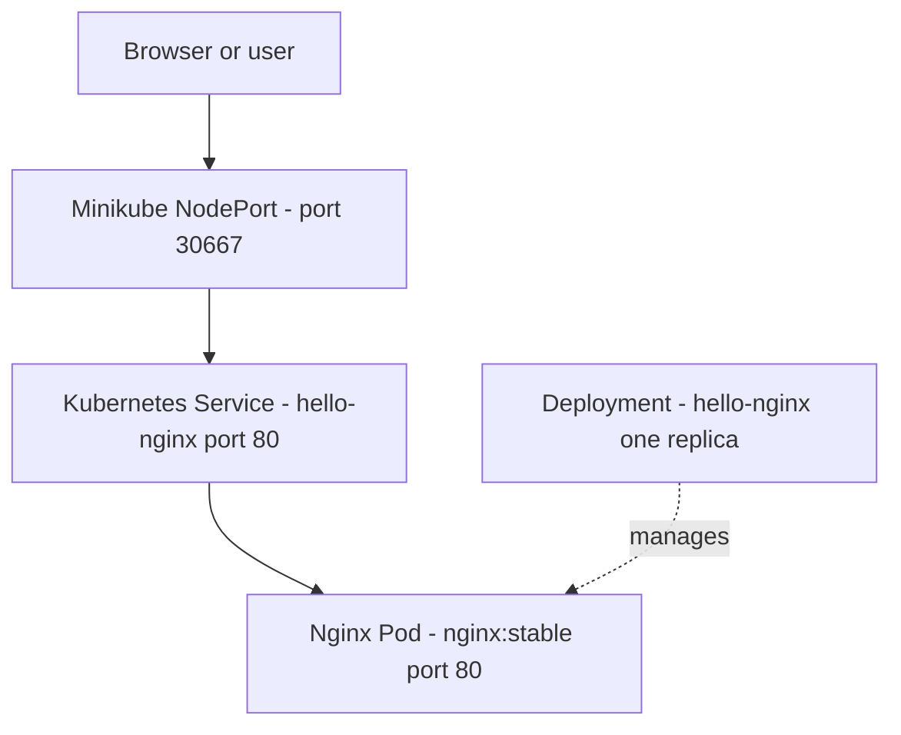
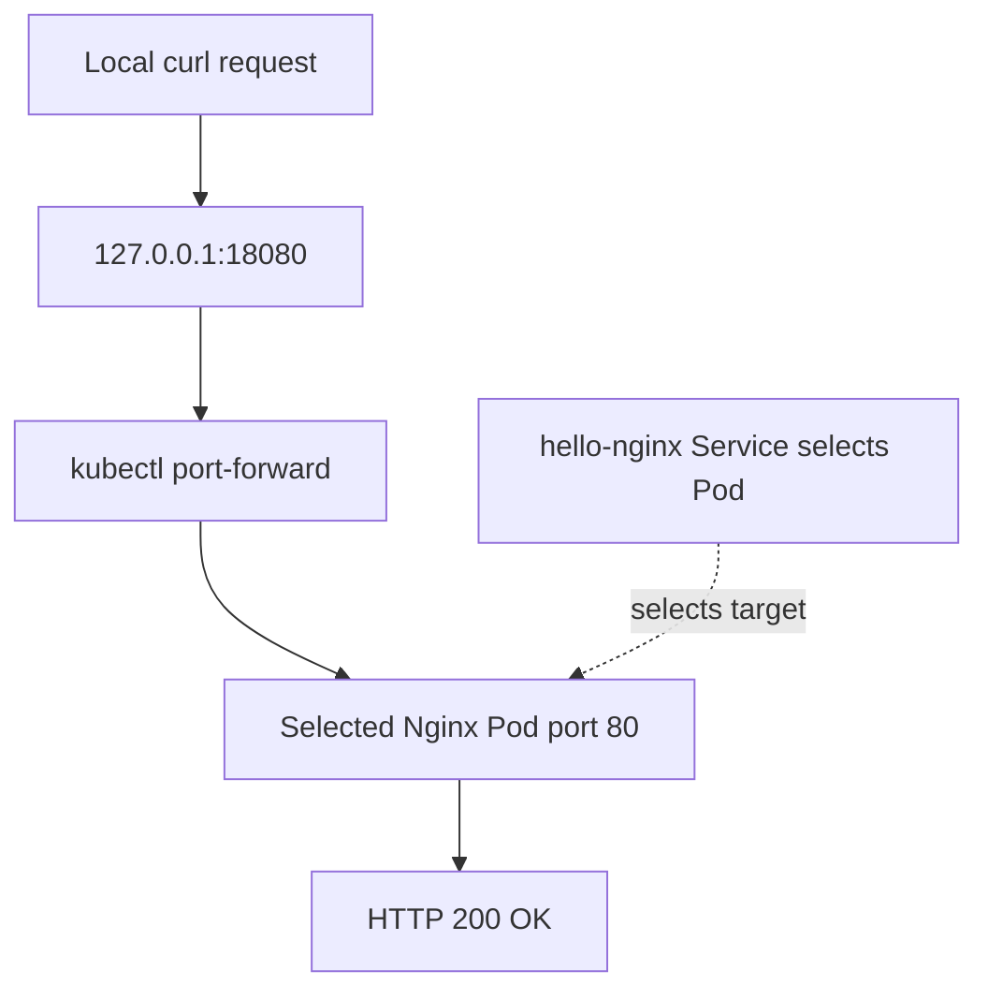
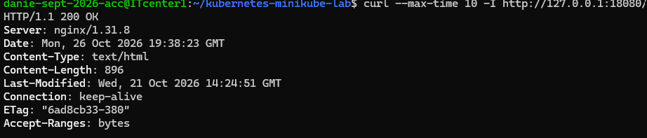

# Kubernetes Minikube Lab — Nginx Deployment

## Project Overview

This project demonstrates deploying an Nginx web server to a local
Kubernetes cluster using declarative YAML manifests.

It is part of my hands-on learning portfolio for AWS Cloud System
Administration, Linux administration, Kubernetes, and DevOps.

## Technology Stack

- Kubernetes
- Minikube
- Docker
- Nginx
- Ubuntu Linux
- YAML

## Kubernetes Resources

### Deployment

File: `deployment.yaml`

Defines a Deployment named `hello-nginx` with one replica using
the `nginx:stable` container image and exposing container port 80.

### Service

File: `service.yaml`

Defines a NodePort Service named `hello-nginx` that selects pods
labeled `app: hello-nginx` and forwards traffic to port 80.

## Repository Files

- `deployment.yaml` — Kubernetes Deployment definition
- `service.yaml` — Kubernetes Service definition
- `README.md` — project documentation
- `.gitignore` — files excluded from Git

## Prerequisites

- Docker
- Minikube
- kubectl, or `minikube kubectl`
- A running local Kubernetes cluster

## Validate the Manifests

Run these commands to validate the manifests without changing
the running cluster:

    minikube kubectl -- apply --dry-run=client -f deployment.yaml
    minikube kubectl -- apply --dry-run=client -f service.yaml

## Deploy to Minikube

After reviewing the changes, apply the manifests:

    minikube kubectl -- apply -f deployment.yaml
    minikube kubectl -- apply -f service.yaml

Check the resources:

    minikube kubectl -- get deployments
    minikube kubectl -- get pods
    minikube kubectl -- get services

Open the Nginx Service locally:

    minikube service hello-nginx

## Cleanup

To delete the resources defined in this project:

    minikube kubectl -- delete -f service.yaml
    minikube kubectl -- delete -f deployment.yaml

Review the resource names before running cleanup commands,
especially if other workloads share your Minikube cluster.

## Security Notes

- Never commit credentials, private keys, or Kubernetes secrets.
- Do not upload your personal kubeconfig file.
- Review YAML manifests before publishing.

## Future Improvements

- Add readiness and liveness probes.
- Define CPU and memory requests and limits.
- Add ConfigMaps and Secrets.
- Automate deployment with a Jenkins pipeline.

## Architecture Diagram

This diagram represents the Kubernetes resources observed in Minikube. NodePort 30667 was the value observed during the captured run and may change if the Service is recreated.



## Deployment Evidence


This screenshot records the observed Minikube status and the running hello-nginx Deployment, Pod, and NodePort Service.

## Runtime Verification

Inspect resources with `minikube kubectl -- get deployments,pods,services`. Use `minikube kubectl -- describe deployment hello-nginx` to inspect the Deployment and `minikube kubectl -- describe service hello-nginx` to inspect the Service.

The screenshot reflects the state observed during the captured session. Resource names, IP addresses, and NodePort values may differ in later runs.

## HTTP Runtime Verification

The application was tested through a temporary local port-forward. The command `kubectl port-forward service/hello-nginx 18080:80` selects a Pod backing the Service and forwards local TCP port 18080 to port 80 on that Pod. This confirms an HTTP response through the forwarded Pod connection. It does not verify the NodePort path, normal Service networking, public internet reachability, or production readiness.

Start port forwarding in one terminal:

```bash
kubectl port-forward service/hello-nginx 18080:80
```

Keep that terminal open. In a second terminal, run:

```bash
curl --max-time 10 -I http://127.0.0.1:18080/
```

### Observed Result

During the recorded test, this command returned an HTTP success response with these headers:

```text
HTTP/1.1 200 OK
Server: nginx/1.31.8
Content-Type: text/html
Content-Length: 896
```

The response confirms that the application returned an HTTP response during that test session. Headers and content may change if the image or configuration changes.

### Request Flow



The port-forward exists only while its command is running. Stop it with Ctrl+C when the test is complete. The existing deployment screenshot documents resource status.



This terminal screenshot records the successful HTTP response observed during the test session.
