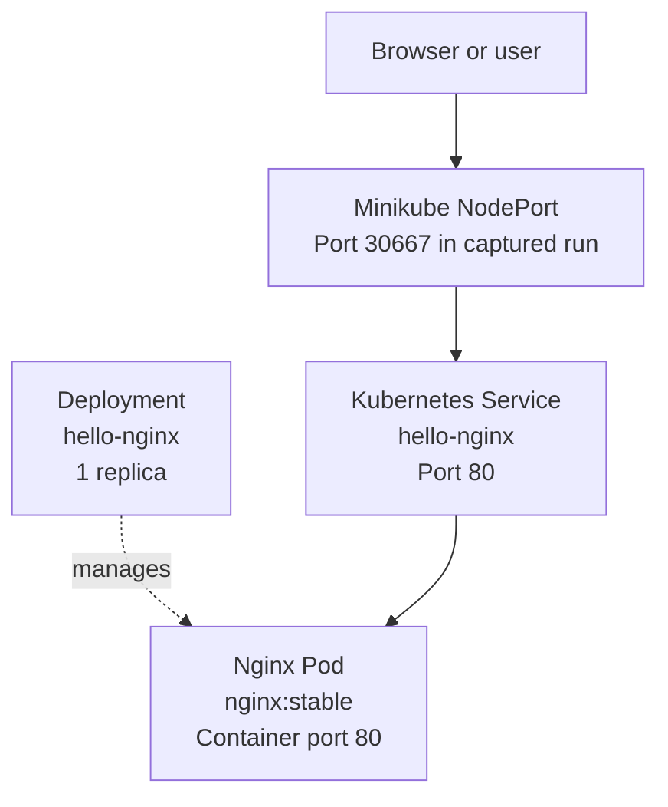
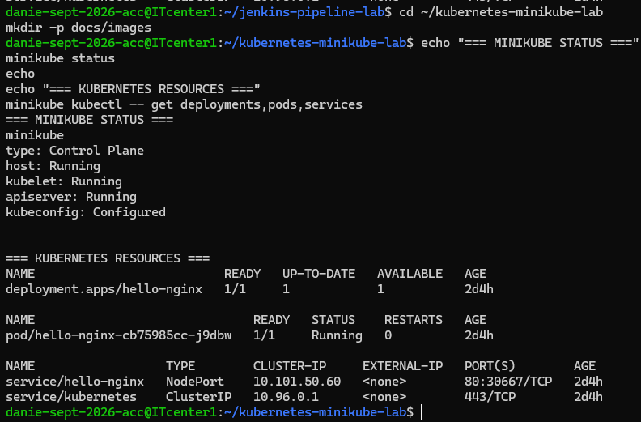
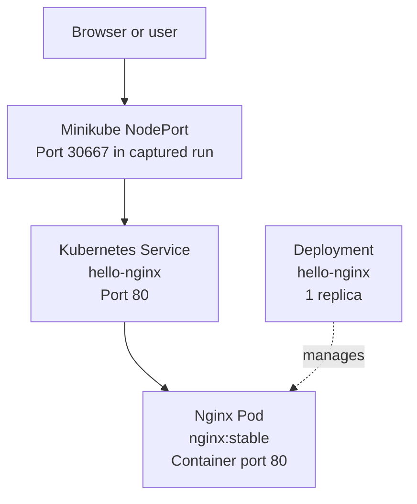

# Kubernetes Minikube Lab — Nginx Deployment

## Project Overview

This project demonstrates deploying an Nginx web server to a local
Kubernetes cluster using declarative YAML manifests.

It is part of my hands-on learning portfolio for AWS Cloud System
Administration, Linux administration, Kubernetes, and DevOps.

## Technology Stack

- Kubernetes
- Minikube
- Docker
- Nginx
- Ubuntu Linux
- YAML

## Kubernetes Resources

### Deployment

File: `deployment.yaml`

Defines a Deployment named `hello-nginx` with one replica using
the `nginx:stable` container image and exposing container port 80.

### Service

File: `service.yaml`

Defines a NodePort Service named `hello-nginx` that selects pods
labeled `app: hello-nginx` and forwards traffic to port 80.

## Repository Files

- `deployment.yaml` — Kubernetes Deployment definition
- `service.yaml` — Kubernetes Service definition
- `README.md` — project documentation
- `.gitignore` — files excluded from Git

## Prerequisites

- Docker
- Minikube
- kubectl, or `minikube kubectl`
- A running local Kubernetes cluster

## Validate the Manifests

Run these commands to validate the manifests without changing
the running cluster:

    minikube kubectl -- apply --dry-run=client -f deployment.yaml
    minikube kubectl -- apply --dry-run=client -f service.yaml

## Deploy to Minikube

After reviewing the changes, apply the manifests:

    minikube kubectl -- apply -f deployment.yaml
    minikube kubectl -- apply -f service.yaml

Check the resources:

    minikube kubectl -- get deployments
    minikube kubectl -- get pods
    minikube kubectl -- get services

Open the Nginx Service locally:

    minikube service hello-nginx

## Cleanup

To delete the resources defined in this project:

    minikube kubectl -- delete -f service.yaml
    minikube kubectl -- delete -f deployment.yaml

Review the resource names before running cleanup commands,
especially if other workloads share your Minikube cluster.

## Security Notes

- Never commit credentials, private keys, or Kubernetes secrets.
- Do not upload your personal kubeconfig file.
- Review YAML manifests before publishing.

## Future Improvements

- Add readiness and liveness probes.
- Define CPU and memory requests and limits.
- Add ConfigMaps and Secrets.
- Automate deployment with a Jenkins pipeline.

## Architecture Diagram

This diagram represents the Kubernetes resources running in the
Minikube learning environment. The NodePort value shown is the
value observed during this run and may change if the Service
is recreated.

## Deployment Evidence

The screenshot records the observed Minikube cluster status and
the running hello-nginx Deployment, Pod, and NodePort Service.

## Validation and Runtime Checks

List the Kubernetes resources:

    minikube kubectl -- get deployments,pods,services

Inspect the Deployment:

    minikube kubectl -- describe deployment hello-nginx

Inspect the Service:

    minikube kubectl -- describe service hello-nginx

The screenshot records the actual state observed during the
captured session. Resource names, IP addresses, and allocated
NodePort values may differ in future runs.

## Architecture Diagram

This diagram represents the Kubernetes resources observed in the
Minikube learning environment. NodePort 30667 was the value observed
during the captured run; it may change if the Service is recreated.

## Deployment Evidence

This screenshot records the observed Minikube cluster status and
the running hello-nginx Deployment, Pod, and NodePort Service.

## Runtime Verification

List the Kubernetes resources:

    minikube kubectl -- get deployments,pods,services

Inspect the Deployment:

    minikube kubectl -- describe deployment hello-nginx

Inspect the Service:

    minikube kubectl -- describe service hello-nginx

The screenshot reflects the state observed during the captured
session. Resource names, IP addresses, and NodePort values may differ
in subsequent runs.
